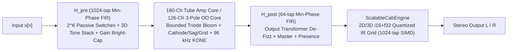

# Clean-Room DSP Profiler (`cleanroom-dsp-profiler`)

[](https://github.com/colganr/cleanroom-dsp-profiler/actions/workflows/ci.yml)
[](LICENSE)

A **clean-room, black-box audio DSP profiling toolkit, Pure-Rust starter engine, and portable AI coding-agent skill** for capturing guitar amplifiers, overdrive/boost pedals, and multi-microphone speaker cabinets with **>99% held-out waveform correlation** across interactive knobs and switches.

Built to help audio DSP engineers and fellow AI-agent users skip months of trial and error on Wiener–Hammerstein separation, 12AX7 triode **bloom**, B+ power-supply **sag**, cathode-bypass dynamics, coupled `V1 → V2` interstage saturation, 96 kHz recurrent **KONE** reservoirs, scale-penalized ridge regression, and real-time zero-allocation Pure-Rust SIMD code.

---

## Architecture Overview

Static neural snapshots freeze every knob and toggle at one setting. Naive block models that lump the entire linear impulse response before a waveshaper starve highs entering clipping stages and leave distortion harmonics unfiltered (`3–4 dB` spectral error).

`cleanroom-dsp-profiler` factors nonlinear gear into a continuous, interactive **Wiener–Hammerstein** architecture:



### Core Innovations Distilled in This Toolkit

- **Exact Wiener–Hammerstein $H_{\text{pre}} / H_{\text{post}}$ Separation:** Captures small-signal total response via settled **bipolar `±1e-4` impulses** (eliminating DC drift and high-gain clipping), isolates post-clipping $H_{\text{post}}(f)$ via **hard-saturated quadrature lock-in sine sweeps**, deconvolves $H_{\text{pre}} = H_{\text{tot}} / H_{\text{post}}$, and folds interactive EQ deltas in real time using the **real cepstrum** (`cepstral_fir.rs`).
- **Bounded Zero-Slope 12AX7 Triode "Bloom" (`sat_bloom_bounded`):** Captures the `+1.5–1.8 dB` mid-signal gain expansion of cold-biased triodes while enforcing exact unit small-signal slope ($\text{sat}_0'(0) = 1.0$) and clean rail asymptotes at extreme drive.
- **Universal 180-Channel Amplifier Core:** Combines `126` 3-pole (`180 / 720 / 2400 Hz`) + coupled `V1 → V2` interstage zero-slope branches, `48` channels of a **96 kHz 2× oversampled clean-room 16-state KONE recurrent reservoir** modulated by `95 Hz` cathode bypass, `12 Hz` B+ sag, and `16 Hz` grid conduction, plus `6` `35 Hz / 383 Hz` sag-recovery & envelope-compression channels (plus an optional **3-stage invertible pole-zero tube/transformer spine**).
- **126-Channel 3-Pole Overdrive Core:** Models op-amp/diode feedback loops (both clean-bleed TS/Klon topologies and pure series clippers) across `9` gain brackets (`[0.00..1.00]`).
- **Non-Additive $2^K$ Switch Tensors & Cap-Coupled 3D Tone Stacks:** Captures real passive divider loading instead of summing independent dB deltas (which overshoots by `+10–12 dB` when multiple switches are engaged).
- **Zero-Leakage 15-Second Composite Stimulus & Scale-Penalized Ridge Law:** Enforces strict separation between calibration (`4–8s`) and held-out verification (`8–15s`), with column-scaled Cholesky regularization that prevents linear scale collapse on unseen playing.
- **Bit-Exact Python ↔ Rust Parity + 50–100× Rust FFI Acceleration:** The Python profiler automatically calls the compiled Pure-Rust `cdylib` (`libcleanroom_dsp`) when present, guaranteeing exact feature parity with runtime audio playback (and falling back to pure NumPy when `rustc` isn't installed).

---

## What This Repository Includes

| Component | Location | Description |
| :--- | :--- | :--- |
| **Portable AI Agent Skill** | `skill/cleanroom-dsp-profiler/` | Ready-to-load `SKILL.md` + **6 technical reference manuals** (including Time-Based, Modulation & Dynamics FX) compatible with **Antigravity, Claude Code, Codex, and Cursor** so your AI coding agent follows every guardrail automatically. |
| **End-to-End Profiling Workflow** | `WORKFLOW.md` | Complete 7-stage engineering playbook from parameter discovery & host settling to Rust codegen, held-out null testing, DAW wrapping, and NAM export. |
| **Cross-Platform Python Profiler** | `profiler/amp_profiler/` | Lightweight **NumPy-only** profiling engine (no PyTorch/SciPy required) covering **Amps, Overdrives, 2D/3D Cabs, Spring/Plate Reverbs (SVD + Toeplitz Tone), Analog BBD & Digital Delays, Harmonic/Optical Tremolo (Carrier Demod + SVD), Vactrol+SVF Envelope Filters, and Studio Compressors** via the unified `cleanroom-profiler` CLI (`demo`, `demo-fx`, `discover`, `export-stimulus`, `profile-wav-pair`). |
| **Dual Target Backends** | `profiler/amp_profiler/backends/` | (1) **Cross-Platform Offline WAV-Pair / Hardware Re-Amp** (`Windows / macOS / Linux` — profile any VST3/CLAP/AAX rendered in any DAW or any physical amp/pedal); (2) **Live Headless macOS AudioUnit** (`AudioToolbox` + `CFRunLoop`); plus a clean `TargetBackend` ABC for community PRs. |
| **Clean-Room Pure-Rust DSP Crate** | `dsp-core-rust/` | Zero-allocation `rlib` + `cdylib` crate: `DenormalGuard` (FTZ/DAZ), `[7/6]` Padé `fast_tanh`, runtime-dispatched `AVX2+FMA` / `SSE2` / `NEON` SIMD dot products, `cepstral_fir`, `amp_core`, `pedal_core`, `cab_grid`, `spring_reverb`, `delay_bbd`, `harmonic_trem`, `envelope_filter` (Vactrol+SVF & Soft-Knee Compressor), `nam_capture`, and C ABI FFI. |
| **NAM `v0.5.4` & 24-Bit Cab IR Exporter** | `profiler/amp_profiler/nam_export.py` | Clean-room WaveNet distiller (`standard` / `feather` / `nano`) matching NeuralAmpModelerCore's exact flat weight layout, plus `2048`-sample `48 kHz` `24-bit PCM` `.wav` IR writer. |
| **Synthetic Reference Demo & Test Suite** | `examples/` & `profiler/tests/` | Built-in copyright-free procedural guitar DI generator + synthetic tube amp & overdrive pedal targets, proving bit-exact Python↔Rust parity and `>99%` held-out accuracy out of the box. |
| **Privacy & Clean-Room Audit Gate** | `scripts/audit_public_release.py` | Automated scanner run locally and in GitHub Actions CI to prevent accidental PII, hardcoded OS paths, secrets, or proprietary assets from entering commits or PRs. |

---

## What This Repository Does NOT Include

To keep this project strictly clean-room, legally sound, and focused on core DSP profiling, the following are **explicitly excluded**:

- **No commercial plugin weights, captures, factory presets, IRs, or `.nam` files** — you must supply and locally profile only plugins or hardware you own/have the right to measure.
- **No third-party artwork, UI skins, brand logos, or sprite/asset extractors** — zero copyrighted graphics or UI cloning tools.
- **No binary disassembly, memory dumping, or reverse-engineering scripts** — this toolkit performs **strictly black-box audio I/O system identification** (feeding test signals in and measuring audio out). All KONE reservoir matrices in `reservoir.rs` / `reservoir.py` are 100% mathematically generated clean-room constants.
- **No turnkey DAW plugin installers, GUI frameworks, DRM/licensing, encrypted weight vaults, or cloud update backends** — `dsp-core-rust` provides the compiled audio engine + C ABI + engineering guide (`daw-and-standalone-guide.md`) for integrating into `nih-plug` (VST3/CLAP), AUv2, or `cpal` standalone apps.
- **No copyrighted guitar DI audio stems** — includes a procedural multi-harmonic guitar DI generator for demos/CI; drop in your own `48 kHz` dry guitar `.wav` for musical profiling.
- **No native live VST3/CLAP headless host driver yet** — use the **Cross-Platform Offline WAV-Pair backend** on Windows/Linux/macOS today, or the native macOS AudioUnit backend on macOS. *(Native VST3/CLAP host backends are our #1 welcome PR contribution!)*
- **No pitch-shifters, algorithmic FDN reverbs, or polyphonic synth profilers** — reverb profiling uses low-rank SVD convolution (`SpringReverbEngine`), delays use parametric Hermite + BBD loop FIR/saturation (`DelayBbdEngine`), and modulation covers dual-band LFO crossover tremolos (`HarmonicTremoloEngine`) + Vactrol/SVF envelope filters (`EnvelopeFilterEngine`). *(BBD chorus FM depth profiling, phasers, and algorithmic FDN reverbs are welcome PR additions!)*

---

## 5-Minute Quickstart (Windows, macOS & Linux)

### Prerequisites
- **Python `>= 3.10`** (`numpy` installed automatically; zero PyTorch/SciPy dependency)
- **Rust stable toolchain** *(optional but recommended for 50–100× faster feature extraction and compiling your own plugins)*

### 1. Run the Built-In Clean-Room Synthetic Demo

```bash
git clone https://github.com/colganr/cleanroom-dsp-profiler.git
cd cleanroom-dsp-profiler

# Option A: One-command build & demo (macOS / Linux)
./examples/run_synthetic_demo.sh

# Option B: Cross-platform manual commands (Windows PowerShell / macOS / Linux)
cd dsp-core-rust && cargo build --release && cd ..
python -m pip install -e ./profiler
cleanroom-profiler demo --out-dir captures/demo
```

This builds the Pure-Rust DSP `cdylib`, profiles the built-in synthetic Tube Amplifier (with bloom, sag, bright cap, and post-clipping de-fizz) and synthetic Overdrive Pedal on the 15-second zero-leakage stimulus, exports ready-to-compile Rust weights + a `.nam` file, and prints an unbiased held-out null-test scorecard.

### 2. Profile Any Plugin or Hardware Rig Cross-Platform (Windows / macOS / Linux)

```bash
# Step 1: Export the 15-second zero-leakage 24-bit WAV stimulus (optional: pass --di-wav your_guitar_di_48k.wav)
cleanroom-profiler export-stimulus --out captures/stim_15s.wav

# Step 2: Render captures/stim_15s.wav through your VST3/CLAP/AAX plugin in any DAW
#         (or re-amp through a physical amp/pedal at 48 kHz) -> save as captures/wet_15s.wav

# Step 3: Auto-align latency, factor H_pre/H_post, fit 180-ch Bloom+Sag+KONE, verify held-out accuracy & export Rust + NAM
cleanroom-profiler profile-wav-pair \
  --input-wav captures/stim_15s.wav \
  --output-wav captures/wet_15s.wav \
  --name "My Custom Amp" \
  --out-dir captures/my_amp \
  --export-nam
```

### 3. Live Headless Parameter Sweep (macOS AudioUnit)

```bash
# Discover parameter IDs, min/max/defaults, and exact sample onset latency
cleanroom-profiler discover --type aufx --subtype XXXX --mfg YYYY --probe-impulse
```

Then copy `examples/config_amp_template.json` or `examples/config_pedal_template.json`, fill in your discovered PIDs, and follow [`WORKFLOW.md`](WORKFLOW.md).

---

## Using the Portable AI Agent Skill

Drop `skill/cleanroom-dsp-profiler/` into your AI coding agent's skills directory so your assistant can drive discovery, profiling, Rust DSP scaffolding, and diagnostic null-test debugging end-to-end:

- **Antigravity:** Copy `skill/cleanroom-dsp-profiler` to `~/.gemini/config/skills/cleanroom-dsp-profiler`
- **Claude Code / Codex / Cursor:** Copy `skill/cleanroom-dsp-profiler` into your workspace `.skills/` or `.claude/skills/` directory and reference `skill/cleanroom-dsp-profiler/SKILL.md`

Example prompt once installed:
> *"Use the `cleanroom-dsp-profiler` skill to help me profile my guitar amp capture in `captures/wet_15s.wav`, export Pure-Rust weights into `dsp-core-rust`, and verify held-out waveform correlation and spectral error."*

---

## Legal, Clean-Room & Disclaimer Notice

This software is provided **strictly for clean-room acoustic system identification, audio DSP education, and personal/authorized engineering research** under the [MIT License](LICENSE) (`AS IS`, without warranty or liability of any kind).

Users are solely responsible for complying with all applicable laws, intellectual property rights, and End-User License Agreements (EULAs) of any third-party software or hardware they measure. Never redistribute third-party plugin binaries, proprietary presets, copyrighted IRs, or third-party artwork.

---

## Contributing & Pull Requests

Pull requests are warmly welcomed! See [`CONTRIBUTING.md`](CONTRIBUTING.md) for dev setup, invariants, and high-priority contribution ideas (including native live VST3/CLAP host backends, fuzz/optical-compressor topologies, and SIMD/solver optimizations).
